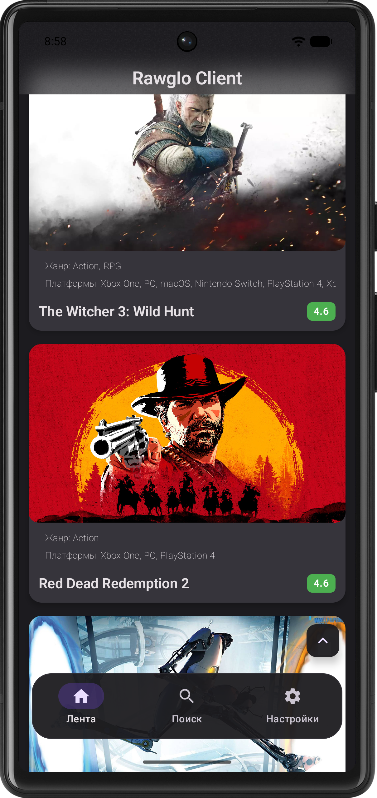
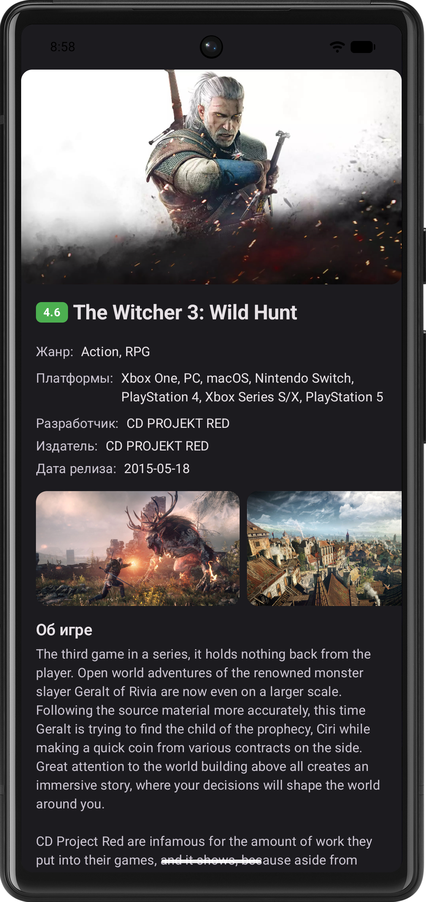
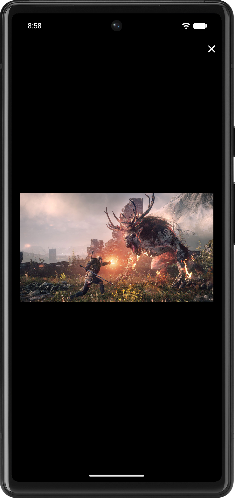
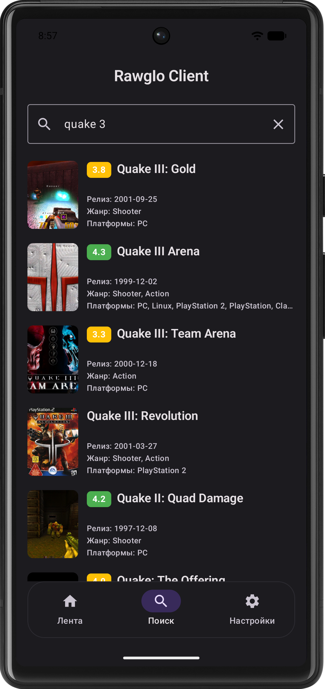
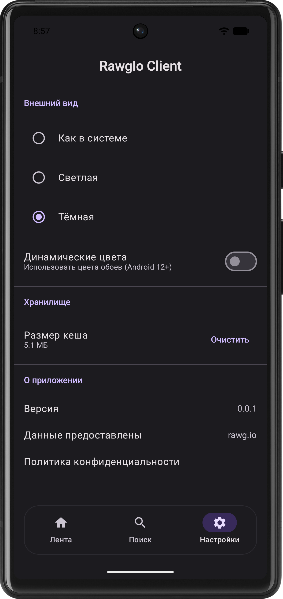

# Rawg io client

Клиент для сервиса [RAWG.io](https://rawg.io/)  
Это рекомендательный сервис компьютерных игр с одной из крупнейших баз данных. Предоставляет открытый [API](https://api.rawg.io/docs/) с лимитами личного использования.

    

## Возможности клиента

* Бесконечная лента игр
* Детальная информация об игре
* Галерея видеороликов и скриншотов игры
* Поиск игр
* Offline-first с кешированием медиаконтента
* Настройки: смена темы, очистка кеша, версия

## Стек проекта

* **Язык**: Kotlin
* **Сборка**: Grdale Kotlin DSL, Convention Plugins, Version Catalog
* **Архитектура**: Многомодульный проект с разделением модулей на api/impl. Внутри каждой фичи разделение по слоям data - domain - presentation. На presentation слое используется MVI.
* **UI**: Jetpack Compose, Material 3
* **Навигация**: Jetpack Navigation 3
* **DI**: Koin
* **Сеть**: Ktor, OkHttp engine, kotlinx serialization
* **Локальные хранилица**: Room, DataStore
* **Медиаконтент**: Media 3 ExoPlayer, Coil
* **Асинхронность**: Kotlin Coroutines, Flow
* **Тестирование**: unit тесты, ui тесты, screenshot тесты, JUnit, MockK, Espresso, Turbine, Roborazzi
